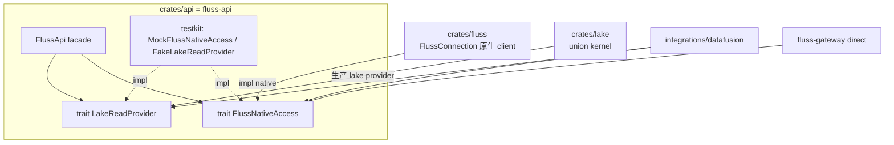
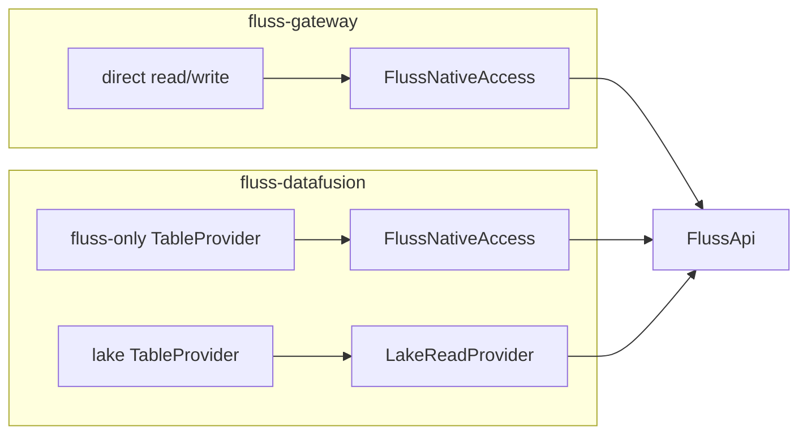

# FIP: `fluss-api` —— 统一的 engine-agnostic client API 层（native + lake）

**Discussion thread**: TBD

**Vote thread**: TBD

**ISSUE**: TBD

**Release**: TBD

---

# Motivation

fluss-rust 目前对外的数据访问能力分散在两个 crate、两种形态：

- **`fluss`（原生 client）** — `FlussConnection` + `Lookuper` / log scanner 等，提供细粒度 KV/Log 点查、前缀、日志扫描与写入；
- **`lake`（union kernel）** — `FlussLakeTable → Scan → Plan → Read` 的 bounded batch union read（lake snapshot + log tail 的 stitch / PK merge，见 [`../lake/FIP.md`](../lake/FIP.md)）。

不同消费者需要的能力面不同：

- **fluss-gateway 的 direct 路径**：只需 `fluss` 原生连接/读写能力；
- **`fluss-datafusion`（`integrations/datafusion`）**：既需要 `fluss` 原生能力（fluss-only 表的下推：point lookup / prefix / bounded scan / log scan），又需要 `lake` 的 union read（lake-enabled 表）。

当前每个消费者都**直接摸具体类型**（`Arc<FlussConnection>`、lake 的入口对象），带来三个问题：

1. **无法注入替身做测试**：`FlussConnection` 是具体 struct，`FlussLakeTable::open` 也吃 `Arc<FlussConnection>`；想在无集群下驱动完整链路（尤其 gateway 想用**一个 mock 后端同时喂 datafusion 和 direct**）做不到——只能起真实集群跑 e2e。
2. **连接生命周期外泄**：重连 / 热交换要靠调用方用闭包把新连接塞回 datafusion，连接管理散在多处。
3. **lake 存储凭据无生产注入口**：服务端按安全策略不下发 S3 `access-key`/`secret-key`，而 datafusion/lake 目前只有 `#[cfg(feature = "integration_tests")]` 的测试桩能补（见 gateway 侧 `lake-s3-credentials-requirement.md`）。

**缺的是一个统一的、engine-agnostic 的 client API 层**：把 fluss-rust 的「原生能力」与「lake 能力」作为两个正交能力面对外暴露，自带可注入替身，让 gateway、`fluss-datafusion` 以及未来任何 Rust engine 都**只依赖这一层**。

本 FIP 描述该 API 层（暂名 `fluss-api`）的需求、能力面、crate 结构与契约边界，作为后续实现基线。

---

# Goals / Non-Goals

### Goals

1. 提供 **engine-agnostic 的统一 client API**，以两个**正交能力面**对外暴露：
   - **native access**：细粒度 KV/Log 读写 + metadata；
   - **lake union read**：沿用 `lake` FIP 的 `table → scan → plan → read` 契约。
2. **可注入替身**：API 层用 trait 定义能力，提供官方 `fake` 实现，使任意消费者能在**无集群**下驱动完整链路（gateway「一个 mock 喂两条路」即由此满足）。
3. **收口连接生命周期**：连接构造、死连接检测 / 有界重连 / 热交换藏在 API 实现内部，对上层透明。
4. **承接 lake 存储凭据注入**：把 lake 存储选项（S3 凭据等）作为 API 层的一等构造参数。
5. 成为 gateway、`fluss-datafusion` 及未来 engine 的**唯一依赖面**，不再让消费者直接持有 `FlussConnection` 具体类型。

### Non-Goals

- **不在 API 层做引擎语义**：SQL 规划 / join / 聚合 / limit 等 residual 算子归上层 engine（对齐 `lake` FIP §12）。
- **不改动 `lake` union kernel 的既有契约**：`FlussLakeTable/Scan/Plan/Read` 形态不变，API 层只做**归拢与可注入化**。
- **不重新实现** seam 解释 / append stitch / PK merge —— 那是 `lake` 的责任。
- **不做协议层**（HTTP / PG / gRPC）——那是 gateway 的责任。
- **不追求把两个能力面合并成一个 trait**（见 Rejected Alternatives）。

---

# Public Interfaces

API 层由**三部分**组成：native 能力 trait、lake 能力（复用 + 可注入接缝）、以及聚合两者的 facade；外加官方替身。

## 1. Native 能力面：`FlussNativeAccess`

细粒度原生读写 + metadata。gateway direct 与 datafusion 的 fluss-only 下推都依赖它。

```rust
#[async_trait]
pub trait FlussNativeAccess: Send + Sync + 'static {
    // 原生读（下推的叶子操作）
    async fn lookup(&self, table: &TablePath, key: &[ScalarValue]) -> Result<RecordBatch>;
    async fn batch_lookup(&self, table: &TablePath, keys: &[Vec<ScalarValue>]) -> Result<RecordBatch>;
    async fn prefix_scan(&self, table: &TablePath, prefix: &[ScalarValue], limit: Option<usize>) -> Result<RecordBatch>;
    async fn log_scan(&self, table: &TablePath, offset: i64, limit: usize) -> Result<RecordBatch>;

    // 原生写（仅 gateway direct 使用；只读引擎可不调）
    async fn write(&self, table: &TablePath, batch: RecordBatch) -> Result<usize>;

    // metadata（catalog 解析 + 元数据端点共用）
    async fn list_databases(&self) -> Result<Vec<String>>;
    async fn list_tables(&self, database: &str) -> Result<Vec<String>>;
    async fn get_table_info(&self, table: &TablePath) -> Result<TableInfo>;
}
```

> 方法清单为**需求草案**；实现前需盘点 `fluss-datafusion` 下推所需的全部叶子操作，确保依赖倒置后不漏能力（见 Open Questions）。

## 2. Lake 能力面：复用 `lake` 契约 + 可注入接缝

lake union read 已是 engine-agnostic 的成熟契约（`FlussLakeTable → Scan → Plan → Read`，输出 `RecordBatchStream`），**不重新设计**。API 层只做两件事：

1. **re-export** `lake` 的公共类型，作为统一 API 面的一部分；
2. 定义一个**可注入接缝**，让消费者（尤其 datafusion 的 lake provider）不直接 `FlussLakeTable::open(conn)`，而是经一个可替换的入口获取 lake 读能力：

```rust
#[async_trait]
pub trait LakeReadProvider: Send + Sync + 'static {
    /// 打开一张 lake-enabled 表，返回其 union read 入口（沿用 lake FIP 的 FlussLakeTable）。
    async fn open_lake_table(&self, table: &TablePath) -> Result<FlussLakeTable>;
}
```

生产实现内部用 `lake` + 注入好的存储选项；测试实现返回预置 `RecordBatchStream`（见 §Testability）。

## 3. Facade：`FlussApi`

聚合连接 + native + lake 的统一入口；消费者拿它即可，无需感知底层 crate。

```rust
pub struct FlussApi { /* opaque: 持有连接 + native access + lake provider */ }

impl FlussApi {
    /// 生产装配：建立连接、注入 lake 存储选项、开启重连管理。
    pub async fn connect(config: FlussApiConfig) -> Result<Self>;

    pub fn native(&self) -> Arc<dyn FlussNativeAccess>;
    pub fn lake(&self) -> Arc<dyn LakeReadProvider>;
}

pub struct FlussApiConfig {
    pub bootstrap_servers: String,
    // 承接 lake 存储凭据注入：caller-wins 覆盖服务端下发的 lake catalog 属性
    pub lake_storage_options: std::collections::HashMap<String, String>,
    // SASL / 重连策略等后续 additive 扩展
}
```

## 4. 官方替身（testkit）

```rust
pub struct MockFlussNativeAccess { /* 内存表 */ }   // impl FlussNativeAccess
pub struct FakeLakeReadProvider  { /* 预置 batch */ } // impl LakeReadProvider
```

一个 `MockFlussNativeAccess` 覆盖 direct + fluss-only SQL；`FakeLakeReadProvider` 覆盖 lake 的协议/调度路径。二者组合 → 消费者无集群跑全栈。

---

# Proposed Changes

## 1. 新 crate `fluss-api`（`crates/api`）

依赖方向严格单向向下，`api` 位于 `fluss` + `lake` 之上：



- `fluss-datafusion` 与 gateway **只依赖 `fluss-api`**；不再直接持有 `FlussConnection`。
- 生产实现（native impl 用 `fluss`，lake provider 用 `lake`）在 `fluss-api` 内组装。

## 2. feature 隔离，避免强拉重依赖

```toml
# crates/api/Cargo.toml（示意）
[features]
default = []                 # 仅 trait + testkit（纯契约，供只读/纯测试消费者）
native  = ["dep:fluss"]      # 生产 native 实现
lake    = ["dep:lake"]       # 生产 lake provider（含存储选项注入）
full    = ["native", "lake"]
```

只想拿 trait 做适配 / 测试的消费者（如某些 datafusion 单测）可 `default-features = false`，不被迫拉入整套 lake / paimon 依赖。

## 3. 连接生命周期收口

`FlussApi::connect` 内部持有连接并负责死连接检测 / 有界重连 / 热交换；对上层完全透明，**消除调用方的 on-swap 闭包**。

## 4. lake 存储凭据注入

`FlussApiConfig.lake_storage_options` 在打开 Paimon catalog 前 merge 进服务端下发的 lake catalog 属性（caller-wins），把原本仅存在于 `integration_tests` 测试桩的能力提升为**正式 API**，解决生产环境读 lake 表因缺 S3 凭据而失败的问题。

---

# 消费者集成（示意）



- **生产**：`let api = FlussApi::connect(cfg).await?;` 后 `api.native()` 给 direct + datafusion fluss-only，`api.lake()` 给 datafusion lake 表。
- **测试**：注入 `MockFlussNativeAccess` + `FakeLakeReadProvider`，同一份内存数据喂两条路。

---

# Prior Art / 业界借鉴

「engine-agnostic 的数据访问 = 一个 API crate、多能力面 trait、官方实现 + 官方 fake」是业界主线，而非「一个 God backend」：

| 项目 | API 层形态 | 能力面 | 官方 fake / 测试实现 |
| ---- | ---------- | ------ | -------------------- |
| **iceberg-rust（`iceberg`）** | 一个 crate 暴露多接口 | `Catalog` + `TableScan` + `FileIO` | memory catalog |
| **`object_store`** | trait + 官方实现 | `ObjectStore` | `InMemory` |
| **DataFusion `datafusion-catalog`** | 多 provider trait 一个 crate | `CatalogProvider`/`SchemaProvider`/`TableProvider` | `MemTable` |
| **InfluxDB IOx** | scannable source 抽象 | `QueryChunk`（热/冷统一） | `TestChunk` |
| **JDBC / OpenDAL** | api 接口包 + driver/adapter | 多操作面 | 各自 mock |

其中 **iceberg-rust 的 `iceberg` crate 最贴**：一个 engine-agnostic API crate 暴露 catalog + scan + io 多能力面，被 `datafusion-iceberg` 等消费，自带内存实现供测试——正是本 FIP 的 fluss 版（native + lake 双能力面）。

---

# Testability（可测试性与测试边界）

- **分层 mock**：`MockFlussNativeAccess` 覆盖 direct + fluss-only SQL；`FakeLakeReadProvider` 覆盖 lake 的协议 / 调度 / 类型映射路径。
- **测试边界（重要）**：API 层与消费者**不重复验证 lake 的 union 语义**（seam / PK merge 的不重不漏、current view）——那是 `lake` crate 自身 façade e2e 的责任（见 `lake` FIP Test Plan）。`FakeLakeReadProvider` 只 mock「lake 源吐什么 batch」，避免把 `lake` 重写一遍。

---

# Compatibility, Deprecation, and Migration Plan

- **对 `fluss` / `lake`**：additive。`fluss-api` 在其之上新增，不改动既有公共 API。
- **对消费者**：`fluss-datafusion` 与 gateway 从「直连 `FlussConnection`」迁移到「依赖 `fluss-api` trait」；迁移分期见下。
- **演进**：能力面按 additive 方式扩展（新增方法 / 新 capability trait），保持 wire/契约稳定。

### 建议分期

1. **一期**：落地 `FlussNativeAccess` + `MockFlussNativeAccess`；gateway direct 与 datafusion fluss-only 下推改依赖它 → 无集群全栈可测。lake 暂仍走真集群 e2e。
2. **二期**：落地 `LakeReadProvider` + `FakeLakeReadProvider`，并把 `lake_storage_options` 注入正式化；datafusion 的 lake 表路径改经 provider → lake 协议/调度路径也可无集群测。

---

# Rejected Alternatives

1. **单一 God backend trait（把 native 点查与 lake union 揉进一个 trait）** — 否决。二者抽象层级不同（细粒度 KV/Log 操作 vs bounded batch scan kernel），揉在一起会造出杂糅巨型接口，且与 `lake` 已有的干净契约打架。
2. **把 lake union 塞进 native port** — 否决。lake 已是 engine-agnostic 的 `table→scan→plan→read` kernel，应作为**正交能力面**复用，而非降级成原生方法。
3. **把 API 层塞进 `fluss` crate** — 否决。统一层需聚合 `lake`（而 `lake` 依赖 `fluss`），放进 `fluss` 会形成反向 / 循环依赖。必须是位于两者之上的独立 crate。
4. **让消费者继续直接吃 `Arc<FlussConnection>`** — 否决。具体类型不可注入替身，无法满足「一个 mock 喂两条路」的测试诉求。
5. **每个 engine 各自实现 native + lake 桥接** — 否决。语义重复、逻辑分散，其他 Arrow engine 无法复用（与 `lake` FIP Rejected §1 同理）。

---

# Open Questions

1. **命名**：crate 名 `fluss-api` vs `fluss-client-api`；trait 名 `FlussNativeAccess` 是否恰当（对标 `object_store::ObjectStore` / iceberg `Catalog`）。
2. **native 方法全集**：需盘点 `fluss-datafusion` 下推实际所需的叶子操作，确定 `FlussNativeAccess` 的精确签名（含分区表、bucket 前缀语义）。
3. **`dyn` vs 泛型**：facade 暴露 `Arc<dyn Trait>`（易注入、动态分发）还是泛型单态化（零开销）；对网络 IO 为主的场景倾向 `dyn`。
4. **谓词类型**：native 面是否复用 `lake` 的 `FlussLakePredicate`，还是各自保留；统一可减少 engine 适配成本。
5. **testkit 归属**：官方 fake 放 `fluss-api` 的 `testing` feature，还是独立 `fluss-api-testkit` crate。
6. **流式输出**：`prefix_scan` / `log_scan` 是否返回 `RecordBatchStream` 而非一次性 `RecordBatch`，以支持大结果与协作取消。
