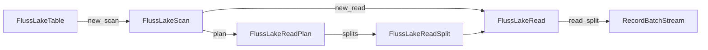
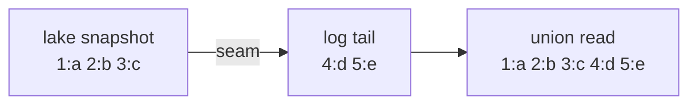
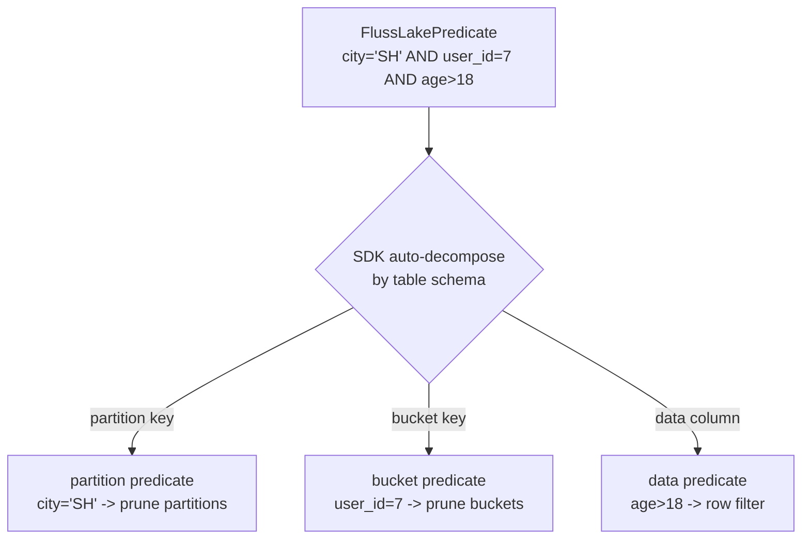
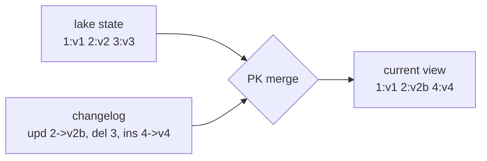
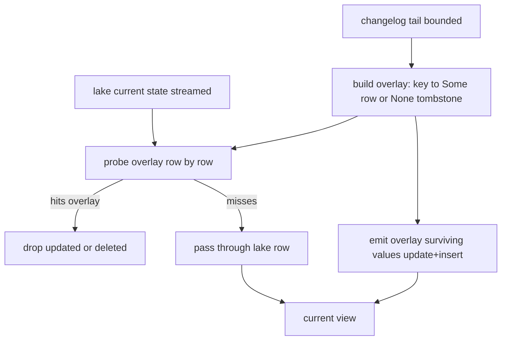

# FIP: `fluss-lake` Union Batch Read Model

**Discussion thread**: TBD

**Vote thread**: TBD

**ISSUE**: TBD

**Release**: TBD

# Motivation

Data in a lake-enabled Fluss table resides on two sides simultaneously:

- **Lake side** — historical data already tiered to Paimon snapshots;
- **Log side** — real-time tail not yet tiered, residing in the Fluss log.

Consumers need a unified batch result rather than dealing with snapshot positioning, seam interpretation, append stitching, and PK merging themselves. `fluss-lake` pushes these concerns down into an engine-agnostic, Arrow-native, client-side read kernel so that upstream engines depend only on stable interfaces.

This FIP covers:

1. A unified **bounded batch** read model for lake-enabled tables;
2. The `table → scan → plan → read_split` public contract;
3. Three read semantics: append/log tables, primary-key tables, and lake-only (`with_lake_only`);
4. A unified split, planning, and execution model for both non-partitioned and partitioned tables;
5. Responsibility boundaries among `fluss-rust`, `fluss-lake`, and upstream engines.

# Public Interfaces

This proposal introduces the following public types:

| Type | Role |
| ---- | ---- |
| `FlussLakeTable` | Entry object representing a lake-enabled Fluss table |
| `FlussLakeScan` | Immutable builder representing one read configuration |
| `FlussLakeReadPlan` | Frozen read plan holding logical splits |
| `FlussLakeReadSplit` | Distributable, serializable logical execution-unit descriptor |
| `FlussLakeRead` | Local reader on the execution side (`Send + Sync`) |
| `FlussLakePredicate` | Engine-agnostic unified predicate type |
| `FlussLakePartitionIdentity` | Unified partition identity |
| `FlussLakePlanStatistics` | Plan-level statistics |
| `FlussLakeError` | Public error surface |
| `RecordBatchStream` | Arrow output stream type |

Design principles:

- Stable entry objects; immutable builder configuration (`with_*` consumes `self`);
- Explicit planning / execution separation;
- Splits are distributable, serializable, checkpoint-able value objects;
- Arrow-native output.

# Proposed Changes

## 1. Read model overview

The core object flow follows `table → scan → plan → read_split`:



This FIP defines only **bounded batch read**, exposing three semantics:

### 1.1 Standard union read

Returns a unified bounded batch result combining the lake snapshot and the Fluss log tail. Consumers need not be aware of the seam, data origin, or internal split organization.



> Terminology: the **seam** is the join point between the lake snapshot and the log tail, corresponding to Fluss's official `readableLogEndOffset` — the confirmed log end offset covered by the readable lake snapshot. The log tail reads from the seam onward, guaranteeing no overlap or gap with the lake.

### 1.2 Lake-only read

Enabled via `with_lake_only(true)`. Returns only the lake snapshot without the log tail. This is an independent user-facing semantic applicable to both append/log and PK tables.

### 1.3 Primary-key current-view read

For PK tables, the union read returns the current view after merging the lake current state with the changelog tail: updates take the tail value, deletes are excluded, inserts appear, and untouched keys retain their lake values.

Upstream engines may choose a fast path for complete primary-key equality or bucket-key prefix equality, but the result semantics must be consistent with the current view.

## 2. Entry: `FlussLakeTable`

```rust
pub struct FlussLakeTable { /* opaque */ }

impl FlussLakeTable {
    pub fn new(
        connection: Arc<FlussConnection>,
        table_path: TablePath,
        schema: Schema,
        num_buckets: i32,
        partition_keys: Vec<String>,
        lake_catalog_properties: HashMap<String, String>,
    ) -> Self;

    /// Recommended entry: fetches metadata and validates lake-readability.
    pub async fn open(
        connection: Arc<FlussConnection>,
        table_path: &TablePath,
    ) -> Result<Self>;

    /// Low-level entry for engine adapters that already hold TableInfo.
    pub fn try_from_table_info(
        connection: Arc<FlussConnection>,
        table_info: &TableInfo,
    ) -> Result<Self>;

    pub fn new_scan(&self) -> FlussLakeScan;
}
```

Future streaming union read will be introduced through a separate entry `new_streaming_scan() -> FlussLakeStreamingScan` (separate FIP), without changing this bounded scan contract.

## 3. Scan: `FlussLakeScan`

```rust
pub struct FlussLakeScan { /* opaque */ }

impl FlussLakeScan {
    pub fn with_projection(self, indices: Vec<usize>) -> Self;
    pub fn with_projection_by_names(self, columns: Vec<String>) -> Self;
    pub fn with_filter(self, filter: FlussLakePredicate) -> Self;
    pub fn with_batch_size(self, batch_size: usize) -> Self;
    pub fn with_lake_only(self, lake_only: bool) -> Self;

    pub async fn plan(&self) -> Result<FlussLakeReadPlan>;
    pub fn new_read(&self) -> Result<FlussLakeRead>;
}
```

| Method | Default | Description |
| ------ | ------- | ----------- |
| `with_projection` | all columns | By column index |
| `with_projection_by_names` | all columns | By column name |
| `with_filter` | `AlwaysTrue` | Unified predicate; SDK auto-decomposes |
| `with_batch_size` | reader default | Max rows per `RecordBatch` |
| `with_lake_only` | `false` | Read lake snapshot only |

`with_*` methods do not mutate in place; scans can be reused and cloned. `plan()` always reads the current latest readable snapshot. Historical snapshot selection may be introduced as a future extension (`with_snapshot_id`).

`FlussLakeScan` is the shared configuration source for both `plan()` and `new_read()` (aligned with Paimon's `ReadBuilder`). Splits do not carry the full scan configuration; in distributed scenarios the upstream engine is responsible for transmitting scan configuration to workers separately.

## 4. Plan: `FlussLakeReadPlan`

```rust
pub struct FlussLakeReadPlan { /* opaque */ }

impl FlussLakeReadPlan {
    pub fn schema(&self) -> SchemaRef;
    pub fn split_count(&self) -> usize;
    pub fn statistics(&self) -> FlussLakePlanStatistics;
    pub fn splits(&self) -> &[FlussLakeReadSplit];
}
```

`plan()` semantics:

1. Freeze the snapshot boundary;
2. Freeze the log stop boundary for each split;
3. Generate the logical split set;
4. Materialize the output schema and statistics.

A plan can be inspected, distributed, and executed. If the table has no snapshot (empty table), `plan()` returns an empty plan with `split_count() == 0` (no error).

## 5. Split: `FlussLakeReadSplit`

```rust
#[derive(Serialize, Deserialize)]
pub struct FlussLakeReadSplit {
    pub split_id: String,
    pub bucket_id: i32,
    pub partition: FlussLakePartitionIdentity,
    pub estimated_rows: Option<usize>,
    pub estimated_size: Option<usize>,
    pub descriptor_version: u32,
    execution_descriptor: Vec<u8>,  // private, opaque
}
```

Split constraints:

- **Logical** — describes "which `(partition, bucket)` to read", does not expose physical Paimon splits;
- **Distributable** — the only public object distributed per task; implements `Serialize`/`Deserialize`;
- **Evolvable** — `descriptor_version` enables wire format evolution;
- **Lightweight** — carries only positioning and execution boundaries, not the full scan config.

`split_id` format: `{table_path}:{partition_id}:{bucket_id}`, for logging/debug only; consumers must not parse its structure.

## 6. Execution: `FlussLakeRead`

```rust
pub struct FlussLakeRead { /* opaque, Send + Sync */ }

impl FlussLakeRead {
    pub async fn read_split(&self, split: &FlussLakeReadSplit) -> Result<RecordBatchStream>;
    pub async fn read_splits(&self, splits: &[FlussLakeReadSplit]) -> Result<RecordBatchStream>;
}
```

- `FlussLakeRead: Send + Sync`; supports sharing via `Arc<FlussLakeRead>` across tasks with safe concurrent calls;
- `read_splits` returns a merged stream of multiple splits; ordering between splits is not guaranteed;
- If a split's referenced log offset has been truncated, returns `FlussLakeError::DataUnavailable`;
- `read_splits(&[])` returns an empty stream.

## 7. Filter: `FlussLakePredicate`

```rust
#[derive(Debug, Clone, PartialEq)]
pub enum FlussLakePredicate {
    AlwaysTrue,
    AlwaysFalse,
    And(Vec<FlussLakePredicate>),
    Or(Vec<FlussLakePredicate>),
    Not(Box<FlussLakePredicate>),
    IsNull { column: String, negated: bool },
    In { column: String, values: Vec<FlussLakeLiteral>, negated: bool },
    Comparison { column: String, op: FlussLakeComparisonOp, value: FlussLakeLiteral },
}

#[derive(Debug, Clone, Copy, PartialEq, Eq)]
pub enum FlussLakeComparisonOp { Eq, NotEq, Lt, LtEq, Gt, GtEq }

#[derive(Debug, Clone, PartialEq)]
pub enum FlussLakeLiteral {
    Null, Boolean(bool), Int32(i32), Int64(i64), Float64(f64),
    String(String), Binary(Vec<u8>),
    Timestamp(i64),  // microseconds since epoch (UTC)
    Date(i32),       // days since epoch
}
```

Convenience constructors: `FlussLakePredicate::eq(col, val)` / `lt` / `gt` / `is_null` / `is_in` / `and` / `or` / `not`, etc.

### Filter semantics

The SDK guarantees **exact filter** semantics: the result set returned by `read_split()` strictly satisfies the pushed-down predicate. Upstream engines need not apply residual filtering.

Implementation strategy: partition/bucket pruning at plan time is naturally exact; data-column predicates are handled in layers internally — the underlying Paimon reader performs conservative file-stats/row-group pruning (performance optimization), and fluss-lake applies `arrow::compute::filter` to each output `RecordBatch` as a final step to guarantee exactness (following Iceberg-rust's `RowFilter` pattern).

### Automatic partition/bucket extraction

The SDK automatically decomposes predicates into partition predicate, bucket predicate, and data predicates based on the table schema:

1. AND conjuncts referencing only partition key columns → partition pruning;
2. Equality conditions on bucket key columns → bucket pruning;
3. Remaining → row-level value filtering.



This decomposition is transparent to consumers. No filter is equivalent to `AlwaysTrue` (all partitions × all buckets).

## 8. Partitioned table design

The logical split execution unit is uniformly `(partition, bucket)`:

- Non-partitioned: `Unpartitioned + bucket`;
- Partitioned: `KeyValues(partition) + bucket`.

```rust
pub enum FlussLakePartitionIdentity {
    Unpartitioned,
    KeyValues(Vec<(String, String)>),
}
```

`KeyValues` pair order follows the table's partition key definition order; values use the canonical string representation consistent with Fluss `PartitionSpec`.

For partitioned tables, `plan()` automatically: resolves the target partition set based on the filter → resolves the bucket range within each partition → generates `(partition, bucket)` level logical splits → freezes each split's seam/stop boundary. Upstream systems schedule by split without deriving the Cartesian product themselves.

## 9. Append/log table semantics

```text
lake(snapshot at split scope) ++ log_tail([seam, stop))
```

Key requirements: the seam is a precise cut point; the lake + log union is complete with no overlap or gap; consumers need not dedup.

Example:
```text
lake: [1:a, 2:b, 3:c], log tail: [4:d, 5:e]
union read         => [1:a, 2:b, 3:c, 4:d, 5:e]
lake-only read     => [1:a, 2:b, 3:c]
```

## 10. Primary-key table semantics

```text
lake_current_state(split scope) merged with changelog_tail([seam, stop))
```

Merge applies upsert/delete by primary key; consumers read the final current view. PK merge completes independently within each `(partition, bucket)` split.



Example:
```text
lake: {1:v1, 2:v2, 3:v3}, log tail: update 2->v2b, delete 3, insert 4->v4
union read         => {1:v1, 2:v2b, 4:v4}
lake-only read     => {1:v1, 2:v2, 3:v3}
```

### 10.1 Merge execution strategy (non-normative implementation note)

This subsection records the current implementation choice and its evolution direction; it is **not part of the public contract**. Implementations may freely swap the algorithm as long as the result satisfies the current view semantics above.

**Current strategy: hash overlay (hash the small side, stream the big side)**

- Fold the bounded changelog tail into `overlay: PkKey → Option<row>`: `Some` is a surviving value, `None` is a tombstone (delete / update_before); last-writer-wins in offset order.
- Stream the lake current state and probe the overlay row by row: a hit is dropped (updated or deleted), a miss is passed through.
- After the lake is drained, emit the overlay's surviving values (update + insert).
- Memory is `O(tail)`; the big lake side is never fully buffered, on the premise that the tail is bounded and small.



**Why not a sort-merge join yet**

Merge is one-to-one per `(partition, bucket)`, so in principle a bucket-wide globally key-ordered stream would suffice for a merge join (`O(1)` memory and fully streaming). The blocker is that the underlying lake reader currently only guarantees key ordering within a single physical split, not a bucket-wide globally ordered read: a bucket's files are bin-packed by size into multiple key-range-overlapping splits, splits are concatenated in order without merging, and streams from different levels are interleaved. The internal execution task reserves a merge-strategy switch point; once the underlying reader offers a bucket-wide ordered read (or this layer sorts on its own), it can switch to sort-merge as the tail grows to lower memory and support full streaming.

## 11. Supporting types

```rust
pub struct FlussLakePlanStatistics {
    pub split_count: usize,
    pub estimated_rows: Option<usize>,
    pub estimated_size: Option<usize>,
}

pub type RecordBatchStream = Pin<Box<dyn Stream<Item = Result<RecordBatch>> + Send>>;

#[derive(Debug)]
pub enum FlussLakeError {
    NotLakeReadable(String),
    PlanningFailed(String),
    DataUnavailable(String),
    SchemaIncompatible(String),
    ConnectionError(String),
    Internal(String),
}
```

### Statistics semantics

`estimated_rows` and `estimated_size` are available at both split and plan levels for upstream engine cost estimation and parallelism decisions.

Split-level estimation sources:

| Source | estimated_rows | estimated_size |
| ------ | -------------- | -------------- |
| Lake side | Paimon `DataSplit.merged_row_count()` (from manifest metadata, no data file reads) | `sum(data_file.file_size)` |
| Log side | `stop_offset - seam_offset` (offset difference = record count) | rough estimate or `None` |

Semantic constraints:

- For append/log tables, `estimated_rows` is an exact value (lake rows + log records);
- For PK tables, `estimated_rows` is an upper bound (merge may deduplicate/delete; actual rows ≤ estimate);
- After partition/bucket filter, pruned splits are not generated; statistics naturally reflect the filtered range;
- After data-column filter, the number of filtered rows cannot be known in advance; `estimated_rows` remains an upper bound (consistent with Paimon/Iceberg).

Plan-level `estimated_rows` / `estimated_size` is the aggregation of all split estimates. If any split is `None`, the overall value is `None`. Implementations may return `None` in early versions and refine gradually.

## 12. Module boundaries

| Module | Responsibilities |
| ------ | ---------------- |
| `fluss-rust` | Table metadata, lake snapshot/seam RPC, log reading, Arrow decoding |
| `fluss-lake` | Unified batch read semantics, planning freeze, split contract, stitch/merge, Arrow-native API |
| Upstream engine | SQL/predicate translation, split scheduling, residual operators (limit/join/agg) |

Upstream engines must not reimplement seam interpretation, append stitching, or PK merge.

## 13. End-to-end usage sketch

```rust
let lake_table = FlussLakeTable::open(connection, &table_path).await?;

let scan = lake_table
    .new_scan()
    .with_filter(FlussLakePredicate::eq("city", "Shanghai"));

let plan = scan.plan().await?;
let read = scan.new_read()?;

for split in plan.splits() {
    let stream = read.read_split(split).await?;
    // consume Arrow batches
}
```

# Compatibility, Deprecation, and Migration Plan

- **For existing users**: the core mental model is fixed as `table → scan → plan → read_split`; usage patterns remain unchanged.
- **For upstream engines**: engines only need to adapt scan construction, split scheduling, and operator integration; they must not hold stitch/merge semantics.
- **Implementation freedom**: public semantics and object boundaries are fixed; internal algorithms are not.
- **Forward compatibility**: future extensions (richer filter, streaming mode, more statistics) evolve additively.

# Test Plan

The testing focus is system semantics: whether users obtain unified read behavior consistent with this FIP.

**1. Public façade end-to-end tests**

- Append/log table: union read returns lake + log unified result; lake-only read returns lake only;
- PK table: union read returns merged current view; lake-only read returns lake current state only;
- Partitioned tables: correctly plan and read by `(partition, bucket)`; partition filtering takes effect.

**2. Real-tiering system tests**

Launch a real Fluss + Paimon/S3 + tiering service and verify that bounded read semantics are correct after data is tiered.

**3. Contract invariants**

- `plan.schema()` matches the output batch schema;
- `splits()` is stable within the same plan;
- No duplicate, no missing rows;
- `(partition, bucket)` is the unified split organization.

# Rejected Alternatives

**1. Each engine implements lake+log union independently** — semantics repeated, logic scattered, other Arrow engines cannot reuse.

**2. Expose physical lake splits** — binds the contract to Paimon implementation details, hindering evolution.

**3. Separate execution model for partitioned tables** — `(partition, bucket)` already provides unified coverage; a separate model adds unnecessary complexity.

**4. Reader as the distribution object** — the reader is a local object; splits are the natural unit for distribution, checkpointing, and reassignment.

**5. PK tables directly concatenate lake + changelog rows** — exposes intermediate change streams, violating current-view semantics.

**6. Lake-only read treated as an implementation detail** — it is a user-visible, testable, independent semantic important for verifying tiering results.
# FIP: `fluss-lake` public contract, implementation status, and convergence plan

> For the Chinese version, see [FIP.md](./FIP.md).  
> `DESIGN.md` remains the current normative design source; this document reformats the intended contract, current implementation status, and rollout path in FIP form.

|                   | ------ |
| ----------------- | ------ |
| Discussion thread | TBD    |
| Vote thread       | TBD    |
| ISSUE             | TBD    |
| Release           | TBD    |

# Motivation

`fluss-lake` is intended to be Fluss’s **client-side lake+log read kernel**:

- historical data lives in the lake as a Paimon snapshot;
- the residual incremental tail lives in the Fluss log;
- callers should see a single readable table rather than two separate physical sources.

This problem should not be solved independently inside each query engine. What needs to be stabilized is an engine-agnostic read model with:

- a `table -> scan -> plan -> read_split` public flow;
- explicit bounded-batch boundary freezing semantics;
- a public logical split object model;
- one common façade for append/log stitching and PK merge.

A structured FIP is also needed because the implementation is already usable but still differs from the long-term design in `DESIGN.md` in several important ways: splits are not yet distributed DTOs, real lake-side planning still happens during `read_split()`, partitioned tables are still rejected, and so on. These gaps should be recorded explicitly so users and maintainers know what is already contractual and what is still converging.

# Public Interfaces

This proposal concerns the public `FlussLake*` façade and its semantics.

1. **Entry object**
   - `FlussLakeTable`
   - `FlussLakeTable::new_scan()`

2. **Scan configuration and planning**
   - `FlussLakeScan`
   - `FlussLakeScan::with_projection(...)`
   - `FlussLakeScan::with_filter(...)`
   - `FlussLakeScan::with_options(...)`
   - `FlussLakeScan::with_lake_only(...)`
   - `FlussLakeScan::plan()`
   - `FlussLakeScan::new_read()`

3. **Plan and split objects**
   - `FlussLakeReadPlan`
   - `FlussLakeReadPlan::schema()`
   - `FlussLakeReadPlan::split_count()`
   - `FlussLakeReadPlan::splits()`
   - `FlussLakePlanStatistics`
   - `FlussLakeReadSplit`

4. **Execution objects**
   - `FlussLakeRead`
   - `FlussLakeRead::read_split(...)`
   - `FlussLakeRead::read_splits(...)`

5. **Supporting public types**
   - `FlussLakeReadOptions`
   - `FlussLakeReadMode`
   - `FlussLakeReadBoundaryMode`
   - `FlussLakeFilter`
   - `FlussLakePartitionFilter`
   - `FlussLakePartitionIdentity`
   - `RecordBatchStream`
   - `FlussLakeError`

The essential public semantics are:

- `FlussLakeTable` is the entry point;
- `FlussLakeScan` holds one read request’s configuration;
- `plan()` produces a frozen logical split set;
- `FlussLakeReadSplit` is the public split descriptor;
- `FlussLakeRead` is a locally constructed execution object;
- callers distribute splits, not readers.

# Proposed Changes

## 1. Fix the layer boundary of `fluss-lake`

`fluss-lake` sits between `fluss-rust` and upper query engines:

- `fluss-rust`
  - table metadata;
  - lake snapshot / seam RPCs;
  - log-tail reading;
  - Arrow decoding helpers.
- `fluss-lake`
  - boundary freezing;
  - logical split planning;
  - append/log stitching;
  - PK merge;
  - engine-agnostic Arrow read API.
- upper engines such as DataFusion
  - predicate translation;
  - mapping splits to execution partitions/tasks;
  - layering residual filters, limits, and other engine operators.

This means `fluss-lake` should not degrade into a DataFusion-specific helper. It should remain an independent read kernel.

## 2. Fix the public read model

The intended public model is:

```text
FlussLakeTable
  -> new_scan()
  -> FlussLakeScan
      -> plan()      -> FlussLakeReadPlan
      -> new_read()  -> FlussLakeRead
```

Execution then happens via:

```text
FlussLakeRead::read_split(&FlussLakeReadSplit)
FlussLakeRead::read_splits(&[FlussLakeReadSplit])
```

This model conveys three core ideas:

1. `scan` is the shared configuration source for both planning and reading;
2. `plan` and `read` are explicit, separate phases;
3. splits are the distributed/dispatched objects, while readers are local execution objects.

## 3. Fix the bounded batch contract

v1 commits only to bounded batch reads. The core semantics are:

1. `plan()` freezes the lake snapshot and each split’s log stop boundary;
2. `read_split()` executes under that frozen boundary;
3. `split_count()` and `splits()` are stable within one plan;
4. the result is a repeatable bounded snapshot view.

## 4. Fix the target role of splits

`FlussLakeReadSplit` is intended to be:

- public;
- logical;
- per-task;
- future distributed;
- executable under a semantically equivalent scan configuration.

It should not be understood as:

- a physical Paimon `DataSplit`;
- a seam DTO;
- the append/PK internal task graph.

The long-term goal is to make the split a stable serializable descriptor that can support checkpointing, reassignment, and distributed execution.

## 5. Keep one façade for append/log and PK tables

Externally, append/log tables and PK tables should share the same public API:

- `table -> scan -> plan`
- `scan -> new_read()`
- `read.read_split(split)`

The difference remains internal.

### append/log table

One logical split means:

```text
lake(snapshot at bucket b) ++ log_tail([seam, stop))
```

Required properties:

- the seam is an exact cut;
- `lake ++ log_tail` is a plain concatenation;
- no duplicates and no gaps;
- no deduplication needed.

### primary-key table

One logical split means:

```text
lake_current_state(bucket b) merged with changelog_tail([seam, stop))
```

Required properties:

- the lake side is deduplicated current state;
- the log side is a bounded changelog continuation;
- merge overlays by primary key;
- v1 supports only the deduplicate merge engine and rejects deletion vectors.

## 6. Record what is already true today

Based on the current `src/api.rs`, `src/append.rs`, and `src/pk.rs`, the implementation already has a stable skeleton:

1. the `FlussLakeTable -> new_scan() -> plan() / new_read()` façade exists;
2. `plan()` already:
   - distinguishes append vs PK;
   - resolves the snapshot seam;
   - freezes the latest bucket offsets as bounded stops;
   - produces bucket-level logical splits;
   - but does **not yet** complete true Paimon lake-side planning at plan time; real catalog/table open and lake planning still happen during `read_split()`;
3. `read_split()` already:
   - executes `lake ++ log_tail` for append/log;
   - executes `lake current state + changelog merge` for PK;
4. `lake_only` mode already exists; today it is implemented by pinning `log_stop_offset` to `log_start_offset`, making the residual tail the empty interval `[seam, seam)`;
5. projected output schema is already derived from scan configuration;
6. `read_splits()` already multiplexes multiple split streams into one output stream; today it opens each split sequentially and then combines the opened streams via `select_all`.

## 7. Make the current gaps explicit

The main gaps between current implementation and target contract are:

### 7.1 splits are not distributed DTOs yet

Today `FlussLakeReadSplit` still carries a private `ReadTask` directly. That means splits are only safe to share within one Rust process and cannot yet be serialized to remote workers or used for checkpoint/failover/reassignment.

### 7.2 `plan()` does not yet perform full lake-side planning

The long-term design expects once-per-query Paimon planning and regrouping in `plan()`. Today the real `ReadBuilder::new_scan().plan()` still happens during `read_split()`.

### 7.3 `SnapshotId(i64)` is public, but historical snapshots are not truly implemented

The public variant exists, but today it effectively only works when the requested snapshot id equals the latest one; otherwise the implementation returns not implemented.

### 7.4 partitioned table public shape exists, but execution still rejects it

The public API already includes partition identity and partition filters, but the current target resolver and append/PK execution paths still reject true partitioned lake reads.

### 7.5 there is no scan/split equivalence check yet

The design assumes that a reader should consume splits only under a semantically equivalent scan configuration. Today there is no explicit fingerprint or compatibility validation between `new_read()` and `read_split()`.

### 7.6 `batch_size` is still a placeholder

`FlussLakeReadOptions::batch_size` is public but not yet wired into Paimon or Fluss readers.

### 7.7 statistics are still thin

Current plan statistics are mostly limited to `split_count` and mode; per-split `estimated_rows` and `estimated_size` are still typically absent.

### 7.8 `with_lake_only` is public and should be treated as such

Upper layers already rely on `with_lake_only` to implement `<table>$lake`, so it should be treated as part of the formal public surface rather than a temporary internal switch.

## 8. Define the convergence plan

### Phase 1: align the public contract

Through docs and tests, first make these directions explicit:

- `FlussLakeReadSplit` is a logical split;
- `lake_only` is a formal mode;
- `plan()` owns bounded boundary freezing;
- readers are local, splits are dispatched.

### Phase 2: make splits truly distributable

- introduce a versioned descriptor for `FlussLakeReadSplit`;
- support `Serialize` / `Deserialize`;
- remove private `ReadTask` from the public split struct;
- add round-trip tests for append and PK splits.

### Phase 3: move lake planning into `plan()`

- open catalog/table in `plan()`;
- run Paimon planning at the snapshot anchor;
- regroup physical splits into logical splits;
- record the necessary physical lake input in the split descriptor.

### Phase 4: add scan fingerprint / compatibility checks

Introduce explicit compatibility validation covering at least:

- table identity;
- schema / projection;
- read mode;
- filter shape;
- `lake_only`;
- descriptor version.

### Phase 5: fill the remaining capability gaps

Recommended priority:

1. partitioned table support;
2. historical `SnapshotId(i64)` support;
3. richer statistics and split estimates;
4. `batch_size` wiring;
5. richer filter contract.

# Compatibility, Deprecation, and Migration Plan

- **Impact on existing users:** this proposal primarily clarifies the contract and convergence path; it does not require an immediate breaking API redesign.
- **Current behavior boundary:** in practice, v1 should still be read as mainly supporting bounded batch lake reads for non-partitioned tables; partitioned reads and historical snapshots are not yet truly available.
- **Split DTO evolution:** when the split becomes a serializable versioned descriptor, the façade should remain stable and the change should be concentrated inside the split representation rather than the high-level call pattern.
- **Stronger reader/split checks:** these changes should surface as earlier failures, not as silent result changes.
- **Migration tooling:** none is currently expected.
- **Removal timing:** once versioned split descriptors, plan-time planning, and compatibility checks are stable, the current in-process task-handle assumptions can be retired.

# Test Plan

This proposal cares about system behavior and public contract validation, not only unit internals.

Baseline validation:

- `cargo test -p fluss-lake`

Recommended regression additions:

1. append/log split serialization round-trip;
2. PK split serialization round-trip;
3. invalid / duplicate bucket filter rejection;
4. early failure on reader/split fingerprint mismatch;
5. `SnapshotId(non-latest)` behavior test;
6. stable rejection behavior for partitioned lake tables in the current implementation;
7. lake-only mode returns only the Paimon snapshot;
8. in the long-term target, lake catalog open failures should surface from `plan()` rather than being deferred to `read_split()`.

For system-level verification, the important checks are:

- append/log reads have no gaps and no duplicates;
- PK merge matches current-state semantics;
- `split_count`, `splits`, and `schema` remain stable within one plan;
- lake-only and normal union reads remain clearly distinct in boundary semantics.

# Rejected Alternatives

## 1. Make `fluss-lake` only a DataFusion helper

Rejected because lake+log semantics should be reusable across Arrow engines and should not be shaped by one engine’s internals.

## 2. Expose Paimon `DataSplit` directly

Rejected because upper layers do not need physical split internals as their public dependency. What they need is a stable logical split abstraction.

## 3. Distribute readers instead of splits

Rejected because readers are local execution objects; splits are the right public objects for checkpointing, reassignment, and future distributed scheduling.

## 4. Keep `plan()` as only a seam/offset freezer forever

Rejected because it weakens the meaning of planning and makes split descriptors, statistics, and early-failure behavior harder to converge.

## 5. Treat `lake_only` as a temporary internal switch

Rejected because upper layers already depend on it for the `<table>$lake` read shape, so it should be discussed as part of the formal contract.
