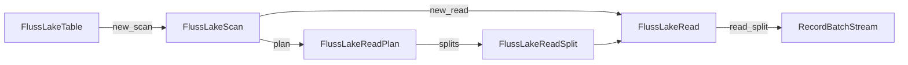
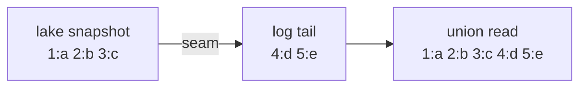
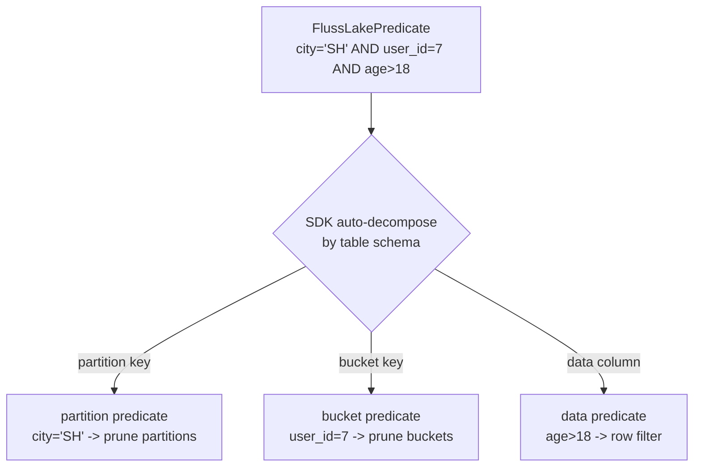
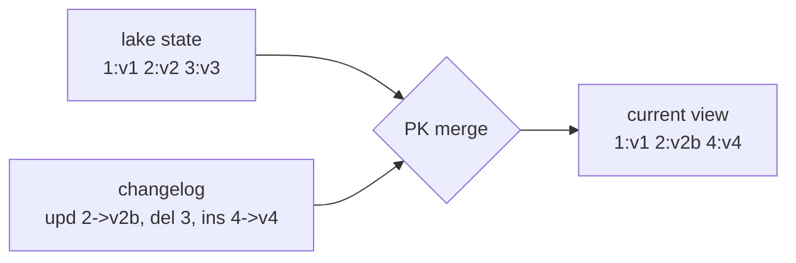
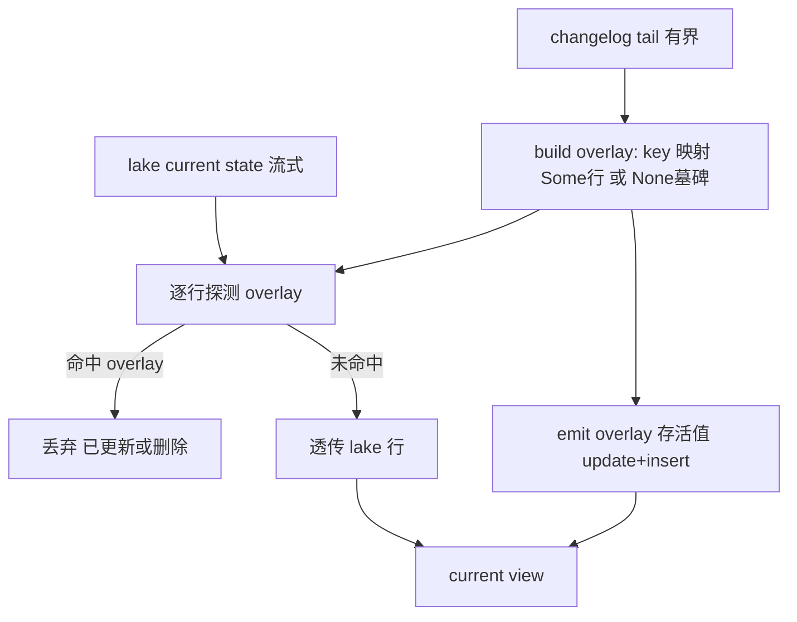

# FIP: `fluss-lake` Union Batch Read Model

**Discussion thread**: TBD

**Vote thread**: TBD

**ISSUE**: TBD

**Release**: TBD

# Motivation

lake-enabled Fluss 表的数据同时存在于两侧：

- **Lake side** — 已 tiered 到 Paimon 的 snapshot（历史数据）；
- **Log side** — 尚未 tiered 的 Fluss log tail（实时尾部）。

调用方需要的是统一的批读结果，而不是自行处理 snapshot 定位、seam 解释、append stitch 和 PK merge。`fluss-lake` 将这些逻辑下沉为 engine-agnostic、Arrow-native 的 client-side read kernel，使上层 engine 只依赖稳定接口。

本 FIP 覆盖：

1. lake-enabled 表的统一 **bounded batch** 读取模型；
2. `table → scan → plan → read_split` 公共契约；
3. append/log 表、primary-key 表与 lake-only (`with_lake_only`) 三种读取语义；
4. non-partitioned / partitioned 统一的 split、planning、execution 模型；
5. `fluss-rust`、`fluss-lake` 与上层 engine 的职责边界。

# Public Interfaces

本提案引入以下公共类型：

| 类型 | 角色 |
| ---- | ---- |
| `FlussLakeTable` | 入口对象，表示一张 lake-enabled Fluss 表 |
| `FlussLakeScan` | 不可变 builder，表示一次读取的配置 |
| `FlussLakeReadPlan` | Frozen 读取计划，持有 logical split 集合 |
| `FlussLakeReadSplit` | 可分发、可序列化的逻辑执行单元描述符 |
| `FlussLakeRead` | 执行端本地 reader（`Send + Sync`） |
| `FlussLakePredicate` | Engine-agnostic 统一谓词类型 |
| `FlussLakePartitionIdentity` | 统一分区标识 |
| `FlussLakePlanStatistics` | 计划级统计信息 |
| `FlussLakeError` | 公共错误面 |
| `RecordBatchStream` | Arrow 输出流类型 |

设计原则：

- 入口对象稳定，配置对象不可变 builder 化（`with_*` 消费 `self`）；
- Planning / execution 显式分离；
- Split 是可分发、可序列化、可 checkpoint 的值对象；
- Arrow-native 输出。

# Proposed Changes

## 1. 读取模型概述

核心对象流转遵循 `table → scan → plan → read_split`：



本 FIP 只定义 **bounded batch read**，对外提供三种语义：

### 1.1 Standard union read

返回 lake snapshot 与 Fluss log tail 的统一 bounded batch 结果。调用方无需感知 seam、数据来源或内部 split 组织。



> 术语说明：**seam** 是 lake snapshot 与 log tail 的连接点，对应 Fluss 官方的 `readableLogEndOffset`——即已确认可读的 lake snapshot 所覆盖的 log 结束偏移量。Log tail 从 seam 开始读取，保证与 lake 不重不漏。

### 1.2 Lake-only read

通过 `with_lake_only(true)` 启用，只返回 lake snapshot，不含 log tail。这是独立的用户语义，append/log 表与 PK 表均适用。

### 1.3 Primary-key current-view read

对 PK 表，union read 返回 lake current state 与 changelog tail merge 后的 current view：更新以 tail 为准，删除不出现，新增出现，未触及的保留 lake 值。

上层 engine 可为完整 primary-key equality 或 bucket-key prefix equality 选择 fast path，但结果语义必须与 current view 一致。

## 2. Entry: `FlussLakeTable`

```rust
pub struct FlussLakeTable { /* opaque */ }

impl FlussLakeTable {
    pub fn new(
        connection: Arc<FlussConnection>,
        table_path: TablePath,
        schema: Schema,
        num_buckets: i32,
        partition_keys: Vec<String>,
        lake_catalog_properties: HashMap<String, String>,
    ) -> Self;

    /// Recommended entry: fetches metadata and validates lake-readability.
    pub async fn open(
        connection: Arc<FlussConnection>,
        table_path: &TablePath,
    ) -> Result<Self>;

    /// Low-level entry for engine adapters that already hold TableInfo.
    pub fn try_from_table_info(
        connection: Arc<FlussConnection>,
        table_info: &TableInfo,
    ) -> Result<Self>;

    pub fn new_scan(&self) -> FlussLakeScan;
}
```

未来 streaming union read 通过独立入口 `new_streaming_scan() -> FlussLakeStreamingScan` 引入（另立 FIP），不改变本 bounded scan 契约。

## 3. Scan: `FlussLakeScan`

```rust
pub struct FlussLakeScan { /* opaque */ }

impl FlussLakeScan {
    pub fn with_projection(self, indices: Vec<usize>) -> Self;
    pub fn with_projection_by_names(self, columns: Vec<String>) -> Self;
    pub fn with_filter(self, filter: FlussLakePredicate) -> Self;
    pub fn with_batch_size(self, batch_size: usize) -> Self;
    pub fn with_lake_only(self, lake_only: bool) -> Self;

    pub async fn plan(&self) -> Result<FlussLakeReadPlan>;
    pub fn new_read(&self) -> Result<FlussLakeRead>;
}
```

| 方法 | 默认值 | 说明 |
| ---- | ------ | ---- |
| `with_projection` | 全列 | 按列索引 |
| `with_projection_by_names` | 全列 | 按列名 |
| `with_filter` | `AlwaysTrue` | 统一谓词，SDK 自动拆解 |
| `with_batch_size` | reader 默认 | `RecordBatch` 行数上限 |
| `with_lake_only` | `false` | 只读 lake snapshot |

`with_*` 不做原地修改，scan 可复用、克隆。`plan()` 始终读取当前最新可读 snapshot（latest readable）。指定历史 snapshot 可作为未来扩展（`with_snapshot_id`）。

`FlussLakeScan` 是 `plan()` 与 `new_read()` 的共享配置源（对齐 Paimon `ReadBuilder`）。Split 不携带完整 scan 配置；分布式场景中上层 engine 负责将 scan 配置单独传输给 worker。

## 4. Plan: `FlussLakeReadPlan`

```rust
pub struct FlussLakeReadPlan { /* opaque */ }

impl FlussLakeReadPlan {
    pub fn schema(&self) -> SchemaRef;
    pub fn split_count(&self) -> usize;
    pub fn statistics(&self) -> FlussLakePlanStatistics;
    pub fn splits(&self) -> &[FlussLakeReadSplit];
}
```

`plan()` 语义：

1. 冻结 snapshot boundary；
2. 冻结每个 split 的 log stop boundary；
3. 生成 logical split 集合；
4. 物化输出 schema 与统计信息。

同一 plan 可 inspect、分发和执行。若表无 snapshot（空表），返回 `split_count() == 0` 的空 plan（不报错）。

## 5. Split: `FlussLakeReadSplit`

```rust
#[derive(Serialize, Deserialize)]
pub struct FlussLakeReadSplit {
    pub split_id: String,
    pub bucket_id: i32,
    pub partition: FlussLakePartitionIdentity,
    pub estimated_rows: Option<usize>,
    pub estimated_size: Option<usize>,
    pub descriptor_version: u32,
    execution_descriptor: Vec<u8>,  // private, opaque
}
```

Split 约束：

- **逻辑性** — 描述"读哪个 `(partition, bucket)`"，不暴露物理 Paimon split；
- **可分发** — 唯一按 task 分发的公共对象，实现 `Serialize`/`Deserialize`；
- **可演进** — `descriptor_version` 用于 wire format 演进；
- **轻量** — 不携带完整 scan 配置，只保留定位与执行边界。

`split_id` 格式为 `{table_path}:{partition_id}:{bucket_id}`，供 logging/debug 使用，调用方不应解析其结构。

## 6. Execution: `FlussLakeRead`

```rust
pub struct FlussLakeRead { /* opaque, Send + Sync */ }

impl FlussLakeRead {
    pub async fn read_split(&self, split: &FlussLakeReadSplit) -> Result<RecordBatchStream>;
    pub async fn read_splits(&self, splits: &[FlussLakeReadSplit]) -> Result<RecordBatchStream>;
}
```

- `FlussLakeRead: Send + Sync`，支持 `Arc<FlussLakeRead>` 跨 task 共享并发调用；
- `read_splits` 返回多 split 合并流，split 间不保证顺序；
- 若 split 引用的 log offset 已被 truncate，返回 `FlussLakeError::DataUnavailable`；
- `read_splits(&[])` 返回 empty stream。

## 7. Filter: `FlussLakePredicate`

```rust
#[derive(Debug, Clone, PartialEq)]
pub enum FlussLakePredicate {
    AlwaysTrue,
    AlwaysFalse,
    And(Vec<FlussLakePredicate>),
    Or(Vec<FlussLakePredicate>),
    Not(Box<FlussLakePredicate>),
    IsNull { column: String, negated: bool },
    In { column: String, values: Vec<FlussLakeLiteral>, negated: bool },
    Comparison { column: String, op: FlussLakeComparisonOp, value: FlussLakeLiteral },
}

#[derive(Debug, Clone, Copy, PartialEq, Eq)]
pub enum FlussLakeComparisonOp { Eq, NotEq, Lt, LtEq, Gt, GtEq }

#[derive(Debug, Clone, PartialEq)]
pub enum FlussLakeLiteral {
    Null, Boolean(bool), Int32(i32), Int64(i64), Float64(f64),
    String(String), Binary(Vec<u8>),
    Timestamp(i64),  // microseconds since epoch (UTC)
    Date(i32),       // days since epoch
}
```

便捷构造器：`FlussLakePredicate::eq(col, val)` / `lt` / `gt` / `is_null` / `is_in` / `and` / `or` / `not` 等。

### Filter 语义

SDK 保证 **exact filter**：`read_split()` 返回的结果集严格满足下推的谓词，上层 engine 无需 residual filtering。

实现策略：partition/bucket pruning 在 plan 阶段天然 exact；数据列谓词由底层做 conservative pruning（性能优化），fluss-lake 在输出流最后一步对每个 `RecordBatch` 应用 `arrow::compute::filter` 保证精确性（参考 Iceberg-rust `RowFilter` 模式）。

### 自动 partition/bucket 提取

SDK 根据 table schema 自动将谓词拆分为 partition predicate、bucket predicate 和 data predicates：

1. AND conjuncts 中只引用 partition key 列的 → 分区裁剪；
2. Bucket key 列上的等值条件 → bucket 裁剪；
3. 其余 → row-level value filtering。

此拆解对调用方透明。未传 filter 等价于 `AlwaysTrue`（全分区 × 全 bucket）。



## 8. Partitioned table design

Logical split 的执行单位统一为 `(partition, bucket)`：

- Non-partitioned: `Unpartitioned + bucket`；
- Partitioned: `KeyValues(partition) + bucket`。

```rust
pub enum FlussLakePartitionIdentity {
    Unpartitioned,
    KeyValues(Vec<(String, String)>),
}
```

`KeyValues` 的 pair 顺序遵循表定义的 partition key 顺序，value 采用与 Fluss `PartitionSpec` 一致的 canonical 字符串表示。

对 partitioned tables，`plan()` 自动：基于 filter 解析目标 partition 集合 → 在每个 partition 内解析 bucket 范围 → 生成 `(partition, bucket)` 级别的 logical split → 冻结每个 split 的 seam/stop boundary。上层按 split 调度，无需自行推导笛卡尔积。

## 9. Append/log 表语义

```text
lake(snapshot at split scope) ++ log_tail([seam, stop))
```

关键要求：seam 是精确切点；lake + log 并集完整、不重不漏；调用方不需要 dedup。

示例：
```text
lake: [1:a, 2:b, 3:c], log tail: [4:d, 5:e]
union read         => [1:a, 2:b, 3:c, 4:d, 5:e]
lake-only read     => [1:a, 2:b, 3:c]
```

## 10. Primary-key 表语义

```text
lake_current_state(split scope) merged with changelog_tail([seam, stop))
```

Merge 按 primary key 应用 upsert/delete，调用方读取最终 current view。PK merge 在每个 `(partition, bucket)` split 内独立完成。



示例：
```text
lake: {1:v1, 2:v2, 3:v3}, log tail: update 2->v2b, delete 3, insert 4->v4
union read         => {1:v1, 2:v2b, 4:v4}
lake-only read     => {1:v1, 2:v2, 3:v3}
```

### 10.1 Merge 执行策略（non-normative 实现说明）

本小节记录当前实现选择与演进方向，**不构成公共契约**：实现方可自由替换算法，只要结果满足上文 current view 语义。

**当前策略：hash overlay（小侧 hash + 大侧流式）**

- 把有界的 changelog tail 折叠成 `overlay: PkKey → Option<row>`：`Some` 为存活值，`None` 为墓碑（delete / update_before）；按 offset 顺序 last-writer-wins。
- lake current state 流式读入，逐行探测 overlay：命中则丢弃（已更新或删除），未命中则透传。
- lake 耗尽后再 emit overlay 中的存活值（update + insert）。
- 内存占用 `O(tail)`，大侧 lake 永不全量缓冲；前提是 tail 有界且小。



**为什么暂不用 sort-merge join**

merge 是 `(partition, bucket)` 一一对应的，理论上只要单 bucket 全局 key 有序即可用归并（内存 `O(1)` 且全流式）。阻塞点在于底层 lake reader 当前只保证单个物理 split 内部 key 有序，不提供 bucket 级全局有序读：一个 bucket 的文件按字节打包成多个 key-range 重叠的 split，跨 split 只顺序拼接不归并，且不同 level 的数据流交错输出。内部执行任务预留了 merge 策略切换位，待底层提供 bucket 级有序读或本层自排序后，可在 tail 规模增大时切换到 sort-merge 以降低内存并支持全流式。

## 11. Supporting types

```rust
pub struct FlussLakePlanStatistics {
    pub split_count: usize,
    pub estimated_rows: Option<usize>,
    pub estimated_size: Option<usize>,
}

pub type RecordBatchStream = Pin<Box<dyn Stream<Item = Result<RecordBatch>> + Send>>;

#[derive(Debug)]
pub enum FlussLakeError {
    NotLakeReadable(String),
    PlanningFailed(String),
    DataUnavailable(String),
    SchemaIncompatible(String),
    ConnectionError(String),
    Internal(String),
}
```

### Statistics 语义

`estimated_rows` 与 `estimated_size` 在 split 级和 plan 级均可用，用于上层 engine 做 cost estimation 和并行度决策。

Split 级估算来源：

| 来源 | estimated_rows | estimated_size |
| ---- | -------------- | -------------- |
| Lake side | Paimon `DataSplit.merged_row_count()`（从 manifest 元数据直接获取，不读数据文件） | `sum(data_file.file_size)` |
| Log side | `stop_offset - seam_offset`（offset 差 = 记录数） | 可粗估或留 `None` |

语义约束：

- 对 append/log 表，`estimated_rows` 是精确值（lake rows + log records）；
- 对 PK 表，`estimated_rows` 是上界估算（merge 可能去重/删除，实际行数 ≤ 估算值）；
- Partition/bucket filter 后，被过滤的 split 不生成，统计自然反映过滤后范围；
- Data column filter 后，无法提前知道过滤掉多少行，`estimated_rows` 仍为过滤前的上界（与 Paimon/Iceberg 一致）。

Plan 级 `estimated_rows` / `estimated_size` 为所有 split 估算值的聚合。任一 split 为 `None` 则整体为 `None`。实现方可在早期版本返回 `None`，后续逐步完善。

## 12. 模块边界

| 模块 | 职责 |
| ---- | ---- |
| `fluss-rust` | 表元数据、lake snapshot/seam RPC、log 读取、Arrow 解码 |
| `fluss-lake` | 统一批读语义、planning freeze、split contract、stitch/merge、Arrow-native API |
| 上层 engine | SQL/predicate 翻译、split 调度、residual 算子（limit/join/agg） |

上层 engine 不应重新实现 seam 解释、append stitch 或 PK merge。

## 13. End-to-end usage sketch

```rust
let lake_table = FlussLakeTable::open(connection, &table_path).await?;

let scan = lake_table
    .new_scan()
    .with_filter(FlussLakePredicate::eq("city", "Shanghai"));

let plan = scan.plan().await?;
let read = scan.new_read()?;

for split in plan.splits() {
    let stream = read.read_split(split).await?;
    // consume Arrow batches
}
```

# Compatibility, Deprecation, and Migration Plan

- **对现有用户**：核心心智固定为 `table → scan → plan → read_split`，不改变使用模式。
- **对上层 engine**：只需适配 scan 构造、split 调度和算子集成，不持有 stitch/merge 语义。
- **实现自由度**：固定公共语义与对象边界，不固定内部算法。
- **向前兼容**：未来扩展（richer filter、streaming mode、更多 statistics）通过 additive 方式演进。

# Test Plan

测试重点是系统语义：用户是否获得与本 FIP 一致的统一读取行为。

**1. Public façade end-to-end tests**

- Append/log table：union read 返回 lake + log 统一结果，lake-only read 只返回 lake；
- PK table：union read 返回 merge 后 current view，lake-only read 只返回 lake current state；
- Partitioned tables：按 `(partition, bucket)` 正确 plan 和 read，分区过滤生效。

**2. Real-tiering system tests**

启动真实 Fluss + Paimon/S3 + tiering service，验证数据经 tiering 后 bounded read 语义正确。

**3. Contract invariants**

- `plan.schema()` 与输出 batch schema 一致；
- 同一 plan 内 `splits()` 稳定；
- 不重不漏（no duplicate, no missing rows）；
- `(partition, bucket)` 统一 split 组织。

# Rejected Alternatives

**1. 每个 engine 自行实现 lake+log union** — 语义重复、逻辑分散、其他 Arrow engine 无法复用。

**2. 暴露物理 lake split** — 把 contract 绑死在 Paimon 实现细节，不利于演进。

**3. 分区表单独设计执行模型** — `(partition, bucket)` 已统一覆盖，单独设计增加复杂度。

**4. Reader 作为分发对象** — Reader 是本地对象，split 才是分发/checkpoint 的天然单元。

**5. PK 表直接拼接 lake + changelog rows** — 暴露中间变化流，违背 current view 语义。

**6. Lake-only read 视为实现细节** — 它是用户可见、可测试的独立语义，对验证 tiering 结果重要。
